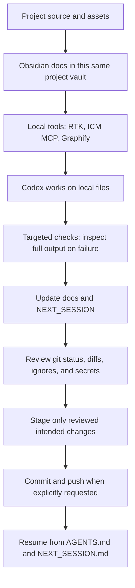

# Development Workflow and Integration Map

[[PROJECT_HOME]] · [[PROJECT_MAP]] · [[OBSIDIAN_SETUP]] · [[BACKUP_WORKFLOW]] · [[NEXT_SESSION]]

Reviewed: 2026-10-16. “Configured” below means verified in this local project; official vendor documentation alone does not prove local setup.

## Workflow

## Integration matrix

| Tool | Identity and useful role | Local status | Permissions, setup, and risks |
| --- | --- | --- | --- |
| Obsidian | Permanent project memory: local Markdown notes for architecture, schema, decisions, bugs, and next tasks. | **CONNECTED locally**: the project root is the vault folder; `docs/` contains project notes. The dashboard previews only an allowlist and does not replace or edit Obsidian notes. | Core Sync is enabled in settings, but account/sync status is **UNVERIFIED**. See [[OBSIDIAN_SETUP]]. |
| Codex | Main development engine; reads project guidance and performs scoped changes/checks. | **CONNECTED** for this local workspace. Session/task/tool history is read from local JSONL logs. On Windows, the dashboard separately reports a basename-matched OS process snapshot. | Session status remains log-derived; process records are point-in-time and are not associated with a project, JSONL session, or role. No app-server connection is configured. See [[AGENT_MONITOR]]. |
| Agent Monitor | Separate local dashboard at `http://127.0.0.1:8765`, independent of Obsidian. | **PARTIALLY CONNECTED**: local JSONL records, Windows process snapshot, explicit named-role ledger, Git state, selected notes, and existing image previews. | Read-only loopback HTTP. No auth; do not expose to a network. Agent role metrics exist only for explicitly recorded runs; no live agent API or role attribution is claimed. See [[AGENT_MONITOR]] and [[AGENT_TEAM]]. |
| RTK | Rust Token Killer CLI filters/summarizes supported command output. Official project: [rtk-ai/rtk](https://github.com/rtk-ai/rtk). | **PARTIALLY CONNECTED**: RTK 1.0.0 is installed at `C:\Users\shizu\.local\bin\rtk.exe`; project/global hook entries are registered and global `RTK.md` is referenced. | `rtk gain` reports “No hook installed” in this session, so automatic rewriting remains **UNVERIFIED**. Restart Codex and trust a project hook only after reviewing it. No telemetry or proxy was enabled. |
| Git | Local version control and diff review. | **CONNECTED locally**: branch `main` tracks `origin/main`. | Preserve the still-dirty Obsidian state, `package-lock.json`, and unrelated note changes. Review and stage only named files; no push was made. |
| GitHub | Remote backup at configured `origin`. | **PARTIALLY CONNECTED**: sanitized remote is `https://github.com/EARL146/app-.git`; local `main` tracks `origin/main`; read-only remote reachability was verified during the audit. A local checkpoint was committed for the monitor work; it has not been pushed. | Do not push without explicit authorization. A push transmits committed source/docs; see [[BACKUP_WORKFLOW]]. |
| ICM | [rtk-ai/icm](https://github.com/rtk-ai/icm), local persistent memory exposed as an MCP server. | **PARTIALLY CONNECTED**: version 0.11.4; `codex mcp get icm` reports it enabled and MCP calls are available. | No account/source upload is configured. Per-project initialization hit a Windows manifest-write error, so ICM uses its local global database. It is not connected to the dashboard event stream. Do not store credentials or customer data. |
| Graphify (user confirmed local) | [Graphify local development docs](https://docs.graphify.com/guides/local-development), a code structure graph generated on this computer. | **CONNECTED locally**: `graphifyy` 0.9.90 is installed; `graphify query` and `graphify update .` work. Obsidian links to local generated graph/report files. | This build indexes code only, not Markdown docs and images. Keep ignored `graphify-out/` local. No hosted account or source upload. |
| GTX | Identity unverified. | **UNVERIFIED / NOT CONFIGURED**: no matching command, MCP tool, or app integration was found in the inspected environment. | Do not install or connect until the exact product and official source are identified. |

## RTK command policy

Use RTK summaries for routine commands only when their output is sufficient. RTK reduces shell-output bytes; that is not a guaranteed reduction in total model tokens, cost, or time. For complete diagnostics, run the original command directly, for example `flutter test --reporter expanded --no-pub`. RTK `--version`, `gain`, and project initialization were checked; Flutter and Git commands in this review were run directly. Never hide a failure or rely only on a summary when debugging.

Official references: [RTK install guide](https://github.com/rtk-ai/rtk/blob/develop/INSTALL.md), [RTK README and supported agents](https://github.com/rtk-ai/rtk/blob/develop/README.md), [RTK Codex hook details](https://github.com/rtk-ai/rtk/blob/develop/hooks/codex/README.md), [ICM](https://github.com/rtk-ai/icm), and Graphify [local development](https://docs.graphify.com/guides/local-development) and [Codex integration](https://docs.graphify.com/integrations/codex).

## Manual and automated boundaries

- **Manual:** choose the task and design reference; decide whether to add menu/business data; review test output and Git diffs; select staged files; authorize commits and pushes; supply unknown product links and permissions.
- **Local and repeatable:** Codex edits repository files; Obsidian reads Markdown from the same root; Git reports diffs; Flutter/PHP checks run from PowerShell. These are not background sync jobs.
- **Local tools:** RTK's project/global Codex hook entries are registered but `rtk gain` reports no active hook; automatic output rewriting is **UNVERIFIED**. ICM MCP is enabled locally; Graphify's local Codex skill and project hook are installed. These per-user installations are not part of the app runtime.
- **Not configured:** RTK Proxy, GitHub app connector, hosted graph service, and Obsidian account sync.
