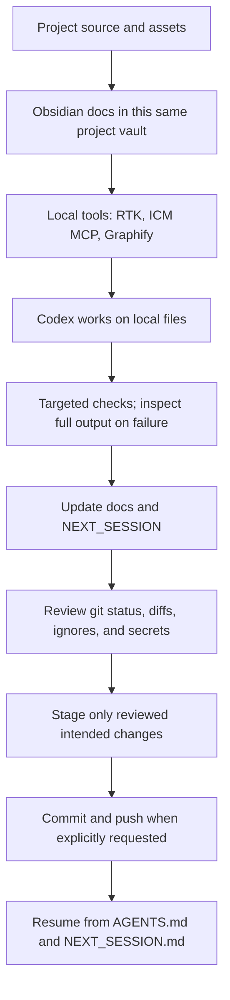

# Development Workflow and Integration Map

[[PROJECT_HOME]] · [[PROJECT_MAP]] · [[OBSIDIAN_SETUP]] · [[BACKUP_WORKFLOW]] · [[NEXT_SESSION]]

Reviewed: 2026-10-14. “Configured” below means verified in this local project; official vendor documentation alone does not prove local setup.

## Workflow

## Integration matrix

| Tool | Identity and useful role | Local status | Permissions, setup, and risks |
| --- | --- | --- | --- |
| Obsidian | Local Markdown vault; File Explorer and Graph core plugins can navigate project notes. | `.obsidian/` exists; Graph and File Explorer are enabled; new notes go to `docs/`. | Same-folder access only; no community plugin required. Core Sync is enabled in settings, but account/sync status is **UNVERIFIED**. See [[OBSIDIAN_SETUP]]. |
| Codex | Current coding workspace reads and edits this repository. | Active for this task; `AGENTS.md` now provides repo guidance. | Local filesystem access is already available here. No separate Obsidian connector is configured or needed because both use the same folder. |
| RTK | Rust Token Killer CLI filters/summarizes supported command output. Official project: [rtk-ai/rtk](https://github.com/rtk-ai/rtk). | RTK 1.0.0 is installed at `C:\Users\shizu\.local\bin\rtk.exe`; project and global Codex hook entries are registered, and global `RTK.md` is referenced from Codex `AGENTS.md`. | Restart Codex and approve the project hook if prompted. `rtk gain` still reports “No hook installed” in this session, so actual automatic rewriting remains unverified. No telemetry or proxy was enabled. |
| Git | Local version control and diff review. | Branch `main` tracks `origin/main`. Keep Obsidian window state and generated Graphify data local. | Local action. Review every staged file; never use `git add .` for this current dirty tree. |
| GitHub | Remote backup at configured `origin`. | Sanitized remote: `https://github.com/EARL146/app-.git`; branch tracks `origin/main`. Read-only remote reachability succeeded. | A push transmits committed source/docs to GitHub. The user explicitly requested publication of the current changes; see [[BACKUP_WORKFLOW]]. |
| ICM | [rtk-ai/icm](https://github.com/rtk-ai/icm), local persistent memory exposed as an MCP server. | Version 0.11.4 installed locally. `codex mcp get icm` reports it enabled and its MCP tools are available; a local preference memory was stored and recalled. | No account or source upload is configured. `icm init --mode mcp --per-project --no-embeddings` added the MCP entry but then hit a Windows error writing `install-manifest.json`; project-specific initialization is not verified. MCP uses the local global database. Do not store credentials or customer data. |
| Graphify (user confirmed local) | [Graphify local development docs](https://docs.graphify.com/guides/local-development), a code structure graph generated on this computer. | Local `graphifyy` 0.9.90 is installed at `%LOCALAPPDATA%\Programs\Graphify-Local\venv\Scripts\graphify.exe`; the user PATH is set. The Codex skill and project hook are under `.codex/`. Code-only extraction plus clustering completed: 1,182 nodes, 1,782 edges, 73 communities. | This build indexes code only, not the project's Markdown docs and images. Run `graphify update .` after code changes. Keep generated `graphify-out/` ignored because it may contain source text and local paths. No hosted account or Graphify service upload. |

## RTK command policy

Use RTK summaries for routine commands only when their output is sufficient. RTK reduces shell-output bytes; that is not a guaranteed reduction in total model tokens, cost, or time. For complete diagnostics, run the original command directly, for example `flutter test --reporter expanded --no-pub`. RTK `--version`, `gain`, and project initialization were checked; Flutter and Git commands in this review were run directly. Never hide a failure or rely only on a summary when debugging.

Official references: [RTK install guide](https://github.com/rtk-ai/rtk/blob/develop/INSTALL.md), [RTK README and supported agents](https://github.com/rtk-ai/rtk/blob/develop/README.md), [RTK Codex hook details](https://github.com/rtk-ai/rtk/blob/develop/hooks/codex/README.md), [ICM](https://github.com/rtk-ai/icm), and Graphify [local development](https://docs.graphify.com/guides/local-development) and [Codex integration](https://docs.graphify.com/integrations/codex).

## Manual and automated boundaries

- **Manual:** choose the task and design reference; decide whether to add menu/business data; review test output and Git diffs; select staged files; authorize commits and pushes; supply unknown product links and permissions.
- **Local and repeatable:** Codex edits repository files; Obsidian reads Markdown from the same root; Git reports diffs; Flutter/PHP checks run from PowerShell. These are not background sync jobs.
- **Local tools:** RTK's Codex hook is registered for this project; ICM MCP is enabled locally; Graphify's local Codex skill and project hook are installed. These per-user installations are not part of the app runtime.
- **Not configured:** RTK Proxy, GitHub app connector, hosted graph service, and Obsidian account sync.
