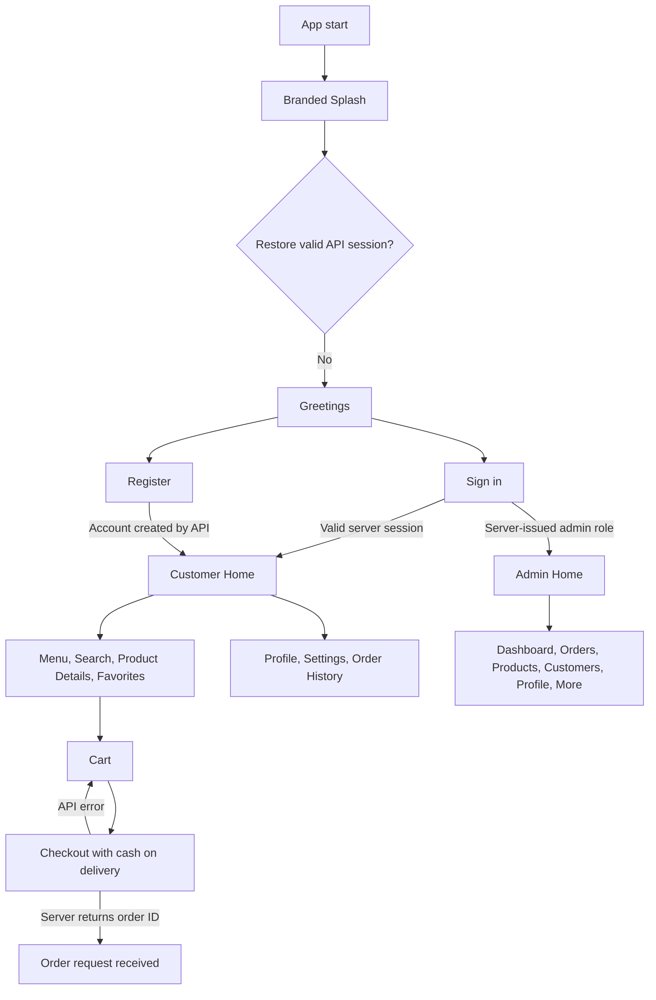

# BurgerBites — Screen Navigation Flow

[[PROJECT_HOME]] · [[SYSTEM_FLOW]] · [[CUSTOMER_FLOW]] · [[ADMIN_FLOW]]

## Current behavior

- `lib/main.dart` starts `AppShell`; its `/` route opens the branded splash screen.
- The splash checks secure session state with `GET /me` when a base URL and saved token exist. A fresh session continues to Greetings.
- Login and registration call `AuthService`; no local account fallback is allowed.
- Customer catalog and admin management data still use local sample data.
- Favorites and checkout call the PHP API routes in `backend/`; the local products route was checked against MySQL. Full account and order journeys remain unverified.
- Android Internet permission is declared. Release API URLs must use HTTPS.

Routes are mapped in `lib/navigation/app_router.dart`; see [[SYSTEM_FLOW]] for algorithms, state, and API contracts.
