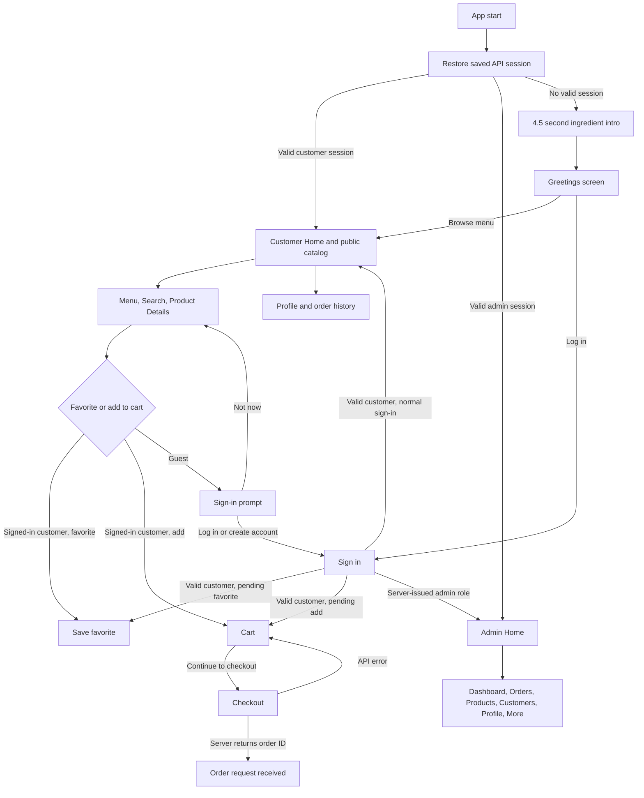

# BurgerBites — Screen Navigation Flow

[[PROJECT_HOME]] · [[SYSTEM_FLOW]] · [[CUSTOMER_FLOW]] · [[ADMIN_FLOW]]

## Current behavior

- `lib/main.dart` starts `AppShell`; its `/` route opens the branded splash screen.
- The splash restores secure session state with `GET /me`. A valid customer or admin session still goes directly to that role's home screen. A fresh session sees the ingredient assembly and BurgerBites wordmark, then the Greetings screen.
- Guests can enter Customer Home and browse the public API catalog, menu, search results, and product details. The catalog request uses `requiresAuth: false`.
- Favorite and add-to-cart controls show a sign-in/create-account prompt for guests. After successful customer sign-in or registration, the pending action resumes on the original screen. Admin sessions cannot use customer actions.
- Checkout also requires a customer session. Normal sign-in, registration, and session restoration continue to route customers and admins to their existing destinations.
- Login, registration, favorites, cart, and checkout use the existing PHP API. No local account or product fallback is added.
- An empty database catalog remains empty in the app. Products must exist in the configured database for the guest menu to display them; the UI does not invent menu items.
- Android Internet permission is declared. Release API URLs must use HTTPS.

Routes are mapped in `lib/navigation/app_router.dart`; see [[SYSTEM_FLOW]] for algorithms, state, and API contracts.
