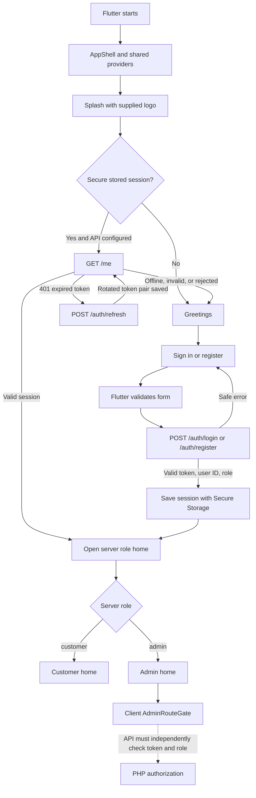
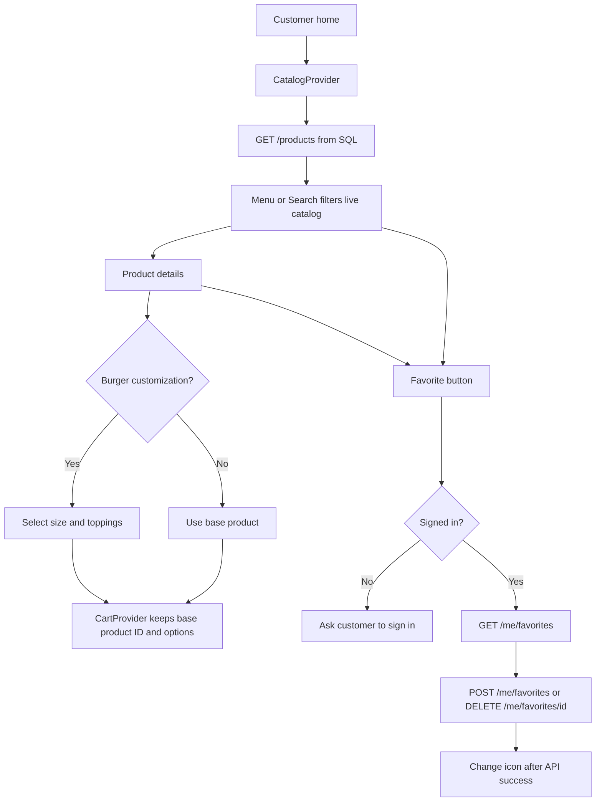
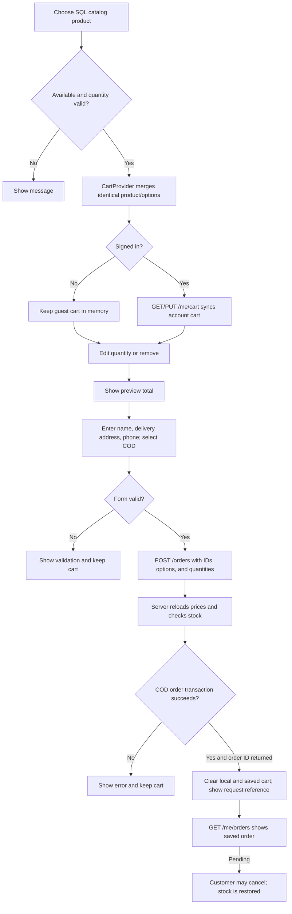
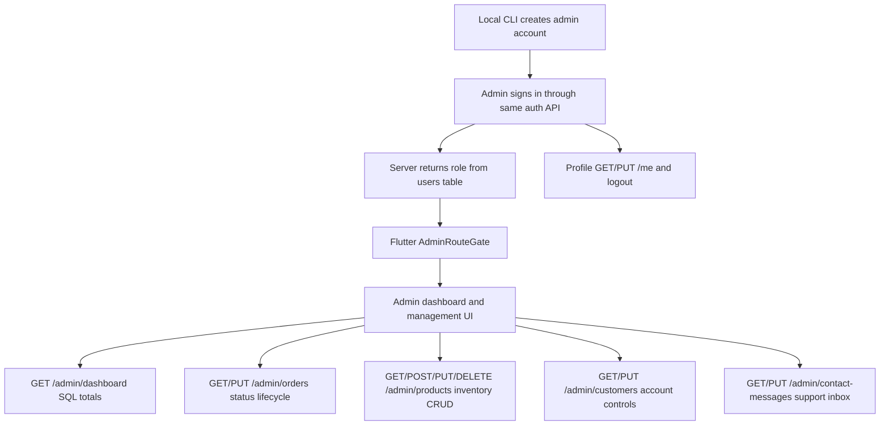
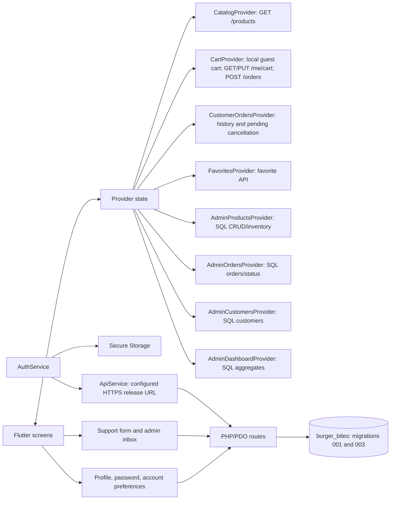

# BurgerBites — Whole System Flow

[[PROJECT_HOME]] · [[SCREEN_FLOW]] · [[CUSTOMER_FLOW]] · [[ADMIN_FLOW]] · [[PRODUCTION_READINESS_AUDIT]] · [[API_SPEC]]

This describes the Flutter app and PHP API code. Migration `001` is installed in local MySQL database `burger_bites`; migration `003_app_workflows.sql` is required for saved carts, reminders, preferences, support, inventory, and expanded order states, but is not yet imported. A local HTTP smoke test passed admin login, `/me`, admin authorization on the readiness endpoint, and logout. Other migration-003 customer/admin workflows still need live verification.

## 1. Startup and authentication

Fresh install goes Splash → Greetings → Sign in/Register. Returning users validate `/me`; if the access token expired, the client uses a refresh token once and retries `/me`. Without `BURGER_BITES_API_BASE_URL`, auth actions fail closed and the app stays in its public flow. No demo credential exists.

## 2. Browse and favorites

Catalog/search read SQL products. Burger options remain tied to the real product row; the server calculates modifier prices instead of trusting client totals. Favorites are scoped to the signed-in user.

## 3. Cart and checkout

The Flutter cart estimate uses a 12% tax and ₱25 delivery fee. Signed-in cart changes sync to `cart_items`; guest carts remain in memory until sign-in. The PHP API re-reads product price/stock and uses configurable tax/delivery values (`ORDER_TAX_PERCENT`, `ORDER_DELIVERY_FEE`). It saves COD order and option snapshots, clears the saved cart, and decrements stock in one transaction. Admin status updates progress through pending, processing, ready, shipped, delivered; cancellation restores stock before dispatch. GCash/Maya stay disabled until sandbox/callback setup is available.

## 4. Admin

There is no default admin account/password. Use `backend/tools/create_admin.ps1` after configuring a dedicated DB. The PHP independently checks the bearer token and admin role. Admin product removal archives the item so order snapshots and foreign keys remain valid.

## 5. Provider and service map

## 6. API route status

| Group | Code status | Runtime status |
| --- | --- | --- |
| Register/login/refresh/logout | PHP handlers implemented | Database configured; complete auth flow not integration-tested |
| Profile GET/PUT | PHP handlers implemented | Database configured; account journey not end-to-end tested |
| Products GET/list/detail | PHP handlers implemented | Code wired to SQL; catalog seed remains unapplied |
| Favorites GET/POST/DELETE | PHP handlers implemented | Database configured; account journey not end-to-end tested |
| COD order creation and customer history | PHP handlers implemented | SQL code wired; migration 003 and live order exercise pending |
| Admin products/orders/customers/dashboard | PHP handlers implemented | SQL code wired; migration 003 and live admin exercise pending |
| Support and preferences | PHP handlers implemented | Requires migration 003; live verification pending |
| Online payments, GPS, email/SMS, localization | Not implemented | Provider/service setup still needed |
| Multiple saved addresses | Not implemented | One default address remains on the user profile |

See [[API_SPEC]], [[DATABASE_SCHEMA]], [[SECURITY]], and [[PRODUCTION_READINESS_AUDIT]].
