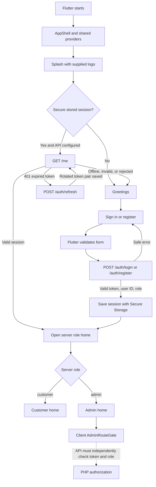
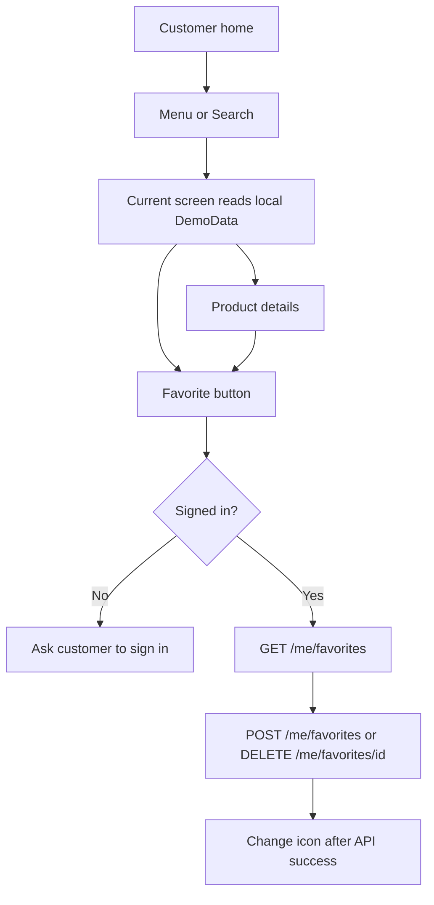
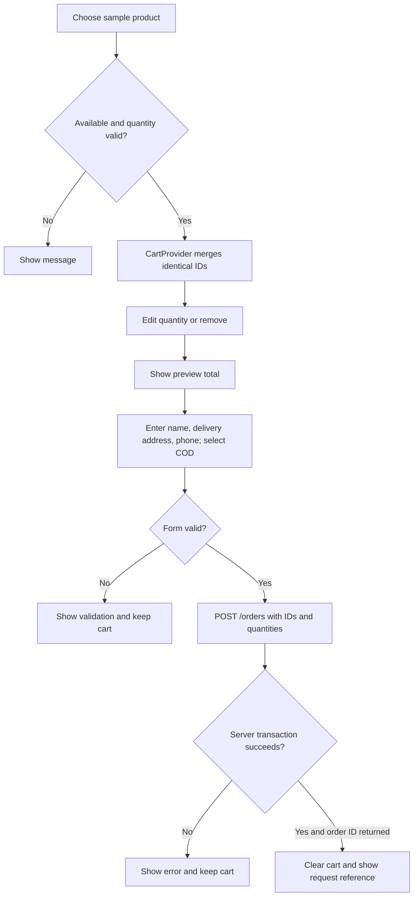
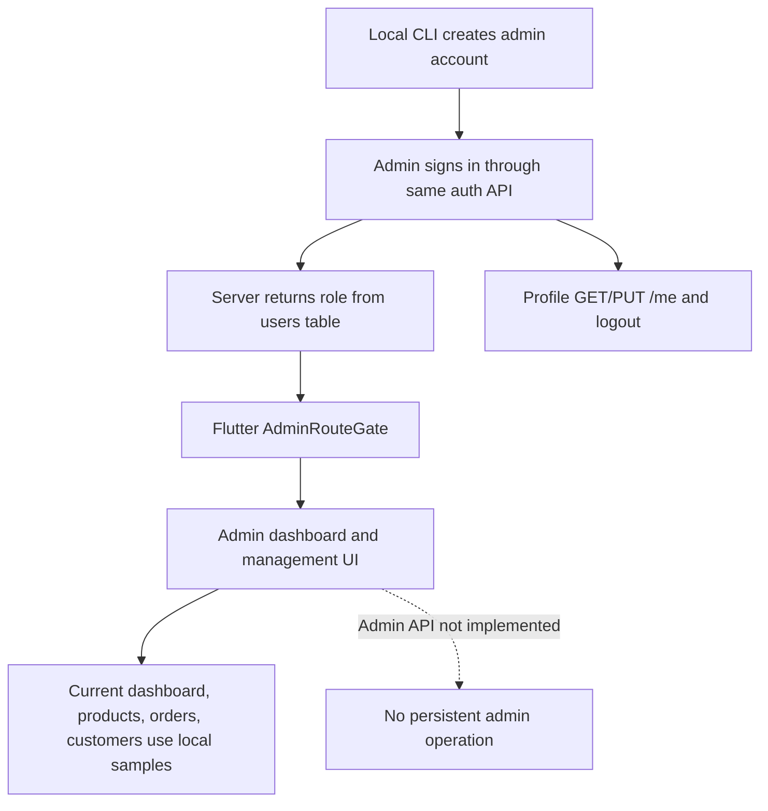
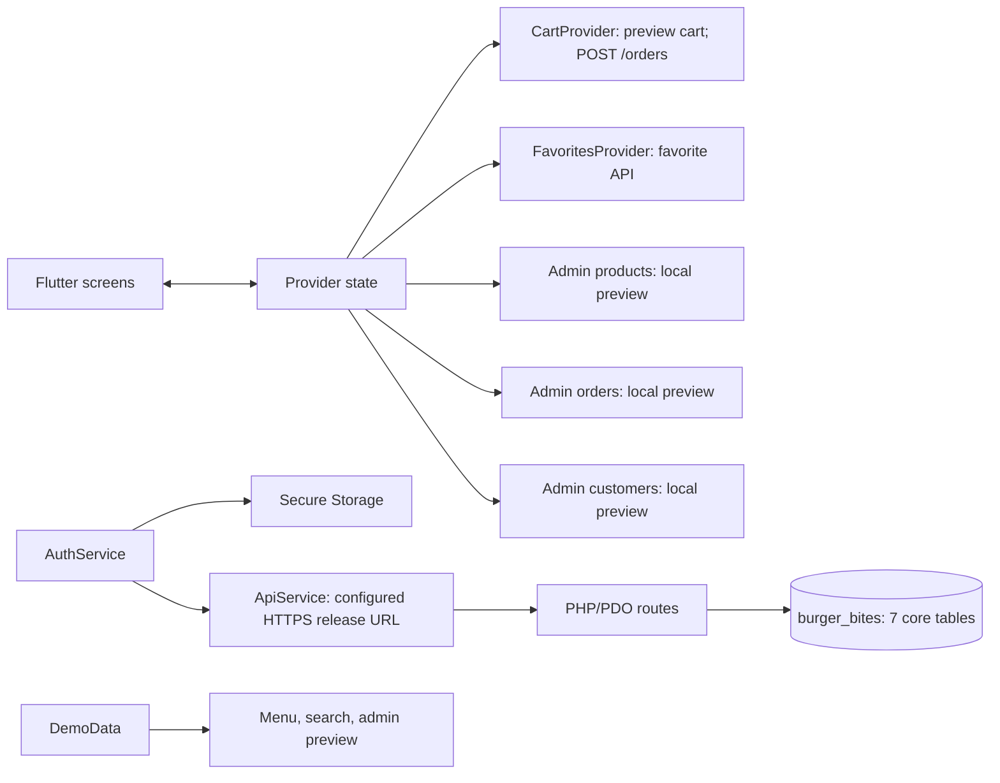

# BurgerBites — Whole System Flow

[[PROJECT_HOME]] · [[SCREEN_FLOW]] · [[CUSTOMER_FLOW]] · [[ADMIN_FLOW]] · [[PRODUCTION_READINESS_AUDIT]] · [[API_SPEC]]

This describes the Flutter app and PHP API code. Migration `001` is installed in local MySQL database `burger_bites`, and the restricted PHP account has passed a database-backed product-list request. Production hosting and several screen integrations remain incomplete.

## 1. Startup and authentication

Fresh install goes Splash → Greetings → Sign in/Register. Returning users validate `/me`; if the access token expired, the client uses a refresh token once and retries `/me`. Without `BURGER_BITES_API_BASE_URL`, auth actions fail closed and the app stays in its public flow. No demo credential exists.

## 2. Browse and favorites

The PHP product read routes exist, but Flutter menu/search do not call them yet. Favorites routes scope reads/writes to the bearer-token user. SQL uniqueness prevents duplicate favorite rows; database behavior is not tested until migration setup.

## 3. Cart and checkout

The Flutter preview uses a 12% tax and ₱25 delivery fee. The PHP API re-reads product price/stock and uses configurable tax/delivery values (`ORDER_TAX_PERCENT`, `ORDER_DELIVERY_FEE`). It writes COD order snapshots and decrements stock in one transaction. These rules are not validated against the restaurant's actual business rules; there is no admin cancel/restock lifecycle yet.

## 4. Admin

There is no default admin account/password. Use `backend/tools/create_admin.ps1` after configuring a dedicated DB. The PHP admin management routes are not implemented; the Flutter gate is only a navigation check.

## 5. Provider and service map

## 6. API route status

| Group | Code status | Runtime status |
| --- | --- | --- |
| Register/login/refresh/logout | PHP handlers implemented | Database configured; complete auth flow not integration-tested |
| Profile GET/PUT | PHP handlers implemented | Database configured; account journey not end-to-end tested |
| Products GET/list/detail | PHP handlers implemented | Flutter screens still use local preview |
| Favorites GET/POST/DELETE | PHP handlers implemented | Database configured; account journey not end-to-end tested |
| COD order creation | PHP handler implemented | Schema configured; order journey not end-to-end tested; no cancel/restock endpoint |
| Admin products/orders/customers | Not implemented | Screens use local preview |
| Customer order history and multiple addresses | Not implemented | Screens/features use preview or single profile address |

See [[API_SPEC]], [[DATABASE_SCHEMA]], [[SECURITY]], and [[PRODUCTION_READINESS_AUDIT]].
