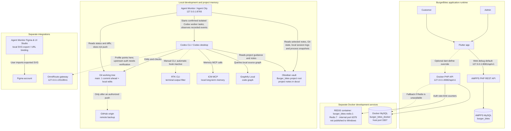

# BurgerBites — Tool and System Connection Flow

Verified locally on 2026-10-21. This note records observed connections and separates the application runtime from development tools. It does not contain credentials.

## Flowchart

## What is connected

| System/tool | Observed status | Boundary or limitation |
| --- | --- | --- |
| Flutter Web → AMPPS API | **Connected locally.** Source defaults to `http://127.0.0.1:8081/api/v1` in Flutter Web debug unless `BURGER_BITES_API_BASE_URL` overrides it. The products endpoint returned HTTP 200 and six products. | This is the current default path for local web development. |
| Docker API → Docker MySQL | **Connected locally.** API returned HTTP 200 on port 8082; MySQL container is healthy on host port 3307. | Separate database and volume from AMPPS. Docker products endpoint returned zero products. Migration 002 (sample catalog) is omitted. |
| Docker API → Redis | **Connected locally.** Redis container is healthy and `redis-cli ping` returned `PONG`. | Redis stores expiring auth rate-limit counters only. It is not product, cart, or order storage. |
| Obsidian | **Connected as local project memory.** `.obsidian/` and project Markdown notes exist under this repository, which project instructions designate as the vault. | Obsidian account sync status is unverified. Obsidian is not part of the app runtime. |
| Agent Monitor / Agent City | **Connected locally.** `/api/overview` returned HTTP 200 on `127.0.0.1:8765`. | Separate from Obsidian. It uses local logs, explicit task records, and point-in-time process snapshots; it does not observe every tool call live or read browser DevTools. |
| ICM | **Connected to this Codex environment.** MCP is enabled and a memory recall succeeded. | Local memory service, not connected to the Agent Monitor event stream. Earlier project initialization had a Windows manifest-write issue. |
| Graphify Local | **Connected locally.** Version 0.9.90; query succeeded from the BurgerBites root against `graphify-out/graph.json`. | Code navigation graph only; not a hosted service and not a replacement for Obsidian notes. |
| RTK | **Partially connected.** Version 1.0.0 is installed; the CLI reports historical output savings. | `rtk gain` reports no active hook in this session. Automatic command interception is unverified. |
| Git / GitHub | **Local Git connected; remote configured.** Current branch is `main`, one commit ahead of `origin/main`, with additional local modifications. | No push was performed. The working tree is dirty; review and preserve existing changes before any commit. |
| OmniRoute | **Partially connected.** Container is healthy, port 20128 responds, and the Codex profile file points to `http://127.0.0.1:20128/v1`. | An unauthenticated `/v1/models` request returned HTTP 401 as expected. This audit did not send credentials or verify upstream Codex authentication. The latest recorded provider check reported no active Codex credentials. |
| Figma | **Not directly connected for Antigravity write-back.** The local dashboard can export SVG artboards and store a local Figma URL reference. | Figma’s current catalog lists Antigravity as local/read-only. Figma write-to-canvas requires an eligible paid or Education plan and a supported remote MCP client. See [Figma MCP catalog](https://www.figma.com/mcp-catalog/) and [Figma MCP requirements](https://help.figma.com/hc/en-us/articles/39216419318551-Get-started-with-the-Figma-MCP-server). |

## Important separation

- AMPPS API/MySQL and Docker API/MySQL are separate development stacks. The live endpoint check returned six products from port 8081 and none from port 8082.
- Redis belongs only to the Docker API's authentication rate-limiting path.
- OmniRoute is an optional AI gateway for Codex. It does not connect the BurgerBites Flutter app to MySQL or Redis.
- RTK, ICM, and Graphify are developer tools, not application services.
- Obsidian remains project documentation and memory. The Agent Monitor is a separate local monitoring UI.
- GitHub is a remote backup only after a reviewed, authorized push; local Git changes do not automatically appear on GitHub.
