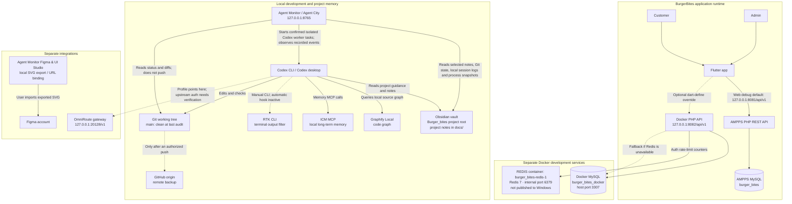

# BurgerBites — Tool and System Connection Flow

Last verified locally on 2026-10-22. This note records observed connections and separates the application runtime from development tools. It does not contain credentials; statuses are snapshots, not guarantees.

## Flowchart

## What is connected

| System/tool | Observed status | Boundary or limitation |
| --- | --- | --- |
| Flutter Web → AMPPS API | **Not reachable in this audit.** The client default is `http://127.0.0.1:8081/api/v1`; GET `/products` failed with connection refused and port 8081 had no listener. | MySQL host port 3306 is listening, but the API-to-database connection was not verified. AMPPS's documented `php82\php.exe` was absent at that path and PHP was not on PATH. |
| Docker API → Docker MySQL | **Unavailable.** Docker Engine was down, port 8082 was closed, and container health could not be inspected. | Do not infer container/data loss. Docker Desktop's VM and container state remain unverified. |
| Docker API → Redis | **Unavailable.** Docker Engine was down and host port 6379 was closed. | Redis is intended only for expiring auth rate-limit counters; its container state could not be inspected. |
| Obsidian | **Project memory files present locally.** `.obsidian/` and project Markdown notes exist under the repository path designated as the vault. | Obsidian app-open and sync status are unverified. It is not part of the app runtime. |
| Agent Monitor / Agent City | **Running locally.** Started the existing read-only server on `127.0.0.1:8765`; `/api/overview` returned HTTP 200. | Server runs in the current foreground Codex execution session. It is log/event-derived and does not observe every Codex tool call live or read browser DevTools. |
| ICM | **Connected to this Codex environment.** The ICM health call and memory recall succeeded. | Local memory service, not connected to the Agent Monitor event stream. |
| Graphify Local | **Installed locally.** `graphify --version` returned 0.9.90. | This audit verified the CLI version, not a fresh graph query/update. It is a local code-navigation graph, not a hosted service or replacement for Obsidian. |
| RTK | **Partially connected.** Version 1.0.0 is installed and `rtk gain` shows historical CLI savings. | `rtk gain` explicitly reports no active hook; automatic command interception is inactive in this session. |
| Git / GitHub | **Local Git clean at this audit.** Branch status was `main...origin/main`. | No commit or push was made. Remote backup contents were not fetched or changed. |
| OmniRoute | **Gateway unavailable.** CLI v3.8.51 is installed, but Docker Engine was down and port 20128 refused connections. | The container could not be inspected. No credentialed request or upstream Codex authentication was verified. |
| Task Observer | **Loaded in Claude Code.** `claude plugin list` reports user-scope version 3.7.0, status loaded. | This does not mean all tool events are visible in the BurgerBites dashboard. |
| Claude-Mem | **Not installed/configured.** It is absent from `claude plugin list` and the marketplace list. | Do not enable a hosted data provider without explicitly reviewing where session summaries are sent. |
| Headroom | **Not installed.** The Headroom venv has no `headroom-ai` package or executable. | No proxy chain to OmniRoute was configured or tested. |
| Figma | **Not directly connected for Antigravity write-back.** The local dashboard can export SVG artboards and store a local Figma URL reference. | Figma’s current catalog lists Antigravity as local/read-only. Figma write-to-canvas requires an eligible paid or Education plan and a supported remote MCP client. See [Figma MCP catalog](https://www.figma.com/mcp-catalog/) and [Figma MCP requirements](https://help.figma.com/hc/en-us/articles/39216419318551-Get-started-with-the-Figma-MCP-server). |

## Important separation

- AMPPS API/MySQL and Docker API/MySQL are separate development stacks. This audit could not reach either API; MySQL alone was listening on host port 3306.
- Redis belongs only to the Docker API's authentication rate-limiting path.
- OmniRoute is an optional AI gateway for Codex. It does not connect the BurgerBites Flutter app to MySQL or Redis.
- RTK, ICM, and Graphify are developer tools, not application services.
- Obsidian remains project documentation and memory. The Agent Monitor is a separate local monitoring UI.
- GitHub is a remote backup only after a reviewed, authorized push; local Git changes do not automatically appear on GitHub.
